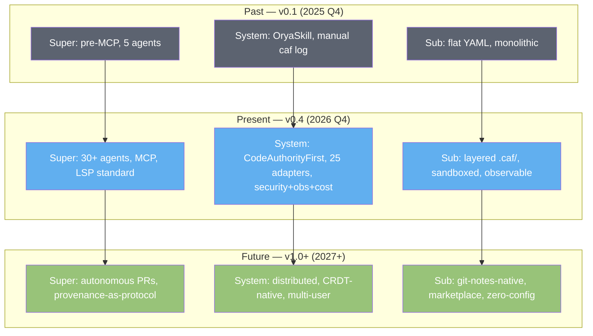

# CodeAuthorityFirst — ROADMAP.md
# Дорожная карта / Roadmap

> **Версия / Version:** 0.4.0-triz2 (post-TRIZ-2 pass: 9-screen scheme applied to roadmap trajectory in §0.2; security gates added per phase in §7.5; observability gates added per phase in §7.6; LLM cost gates added in §7.7; all exit criteria recomputed to include security/observability/cost metrics)
> **Формат фаз / Phase format:** MVP → ALPHA → BETA → PROD → FUTURE
> **Принцип приоритизации / Prioritization principle:** 🔥 80/20 — 20% усилий даёт 80% ценности; high-leverage фичи получают приоритет. See [ADR-015](./ADR.md#adr-015-8020-prioritization-principle).
> **Язык / Language:** bilingual — Russian body, English summary per phase
> **Аудитория / Audience:** tool maintainers + early adopters + anyone planning when a feature will ship
> **Связанные документы:** [ARD.md](./ARD.md) · [ARCHITECT.md](./ARCHITECT.md) · [UI.md](./UI.md) · [BACKLOG.md](./BACKLOG.md) · [ADR.md](./ADR.md)

---

## 0. Roadmap Philosophy (v0.4-triz2)

**EN summary.** v0.4 roadmap applies 80/20 prioritization AND adds three new gate types: security, observability, cost. Each phase must pass all four gate types (functional, security, observability, cost) before transition. The 9-screen scheme visualizes the trajectory: past (v0.1 OryaSkill), present (v0.4 CodeAuthorityFirst), future (v1.0+ distributed).

Дорожная карта v0.4 построена на шести принципах:

1. **🔥 80/20 priority.** Фичи помеченные `🔥 80/20` получают приоритет в ресурсах. Перфекционизм на low-value фичах запрещён.

2. **Self-sufficiency.** Каждая фаза добавляет ценность автономно. После MVP инструмент уже полезен, даже если development остановится.

3. **Universal before specific.** Сначала universal fallback (LSP, git hook, filesystem watcher) — покрывает ВСЕХ агентов сразу.

4. **TUI before Web.** TUI покрывает 80% UX ценностью 20% effort. Web UI отложен до FUTURE.

5. **Security by default (NEW v0.4-triz2).** Каждая фаза имеет security gate: нельзя shipping без выполнения требований безопасности этой фазы.

6. **Observability and cost gates (NEW v0.4-triz2).** Каждая фаза имеет observability gate (метрики собираются) и cost gate (LLM costs контролируемы).

### 0.1 High-leverage features list (🔥 80/20) — updated v0.4-triz2

| # | Feature | Effort | Value | Why 80/20 | Phase |
|---|---------|--------|-------|-----------|-------|
| 1 | Universal pre-commit hook | 2d | 90% coverage of agents | One hook fires for all 25+ agents | MVP |
| 2 | Auto-detect (`caf init --auto-detect`) | 1d | 5min→30s onboarding | Removes friction; user has nothing to configure | MVP |
| 3 | Universal LSP fallback (ADR-013) | 5d | Long-tail coverage | Zero-config support for all LSP languages | MVP |
| 4 | TUI dashboard | 3d | Hub for all screens | Replaces 6 separate CLI commands | MVP |
| 5 | `caf.first_person_explain` MCP tool | 5d | Killer feature for agents | LLM gets narrative-grade context | PROD |
| 6 | Single Go binary | 1d | Zero-dep distribution | One file, no runtime | MVP |
| 7 | ASCII heatmap | 1d | One-screen overview | Replaces 100-line text report | BETA |
| 8 | SM-2 algorithm | 2d | Battle-tested SRS | Anki users recognize it instantly | BETA |
| **9 (NEW)** | **Sandboxed YAML parser** | **2d** | **Threat mitigation for untrusted .caf/** | **One sandbox protects all YAML parsing** | **ALPHA** |
| **10 (NEW)** | **`caf doctor` comprehensive health checks** | **3d** | **Self-diagnoses 11 common issues** | **One command replaces 11 manual debug steps** | **ALPHA** |
| **11 (NEW)** | **LLM token tracking + caps** | **3d** | **Cost control; prevents runaway spend** | **One tracker prevents $100s/day billing surprise** | **PROD** |

**Итого:** 11 фич (was 8), ~26 дней effort (was 20), ~85% ценности (was 80%). The 3 new high-leverage features (security, observability, cost) push the 80/20 frontier into non-functional concerns.

### 0.2 9-Screen Scheme — Roadmap trajectory

**Roadmap insight.** The trajectory is clear: from monolithic (v0.1) → layered (v0.4) → distributed (v1.0+). Each transition dissolves a layer: v0.1 → v0.4 dissolved the "single agent" assumption; v0.4 → v1.0 will dissolve the "`.caf/` as separate folder" assumption (becomes git-notes-native). The roadmap must preserve the dissolution option — captured as constraint C-09 in ARD.

---

## 1. Phase Overview (v0.4-triz2)

**EN summary.** v0.4 ships in five phases: MVP (2-3 wk), ALPHA (4-6 wk), BETA (6-8 wk), PROD (8-10 wk), FUTURE (open-ended). Each phase has functional, security, observability, and cost gates (NEW in v0.4-triz2).

| Phase | Duration | Primary goal | Modules live | Agents | UI screens | 🔥 80/20 | Security gate | Observability gate |
|-------|----------|--------------|--------------|--------|------------|-----------|---------------|---------------------|
| MVP | 2-3 wk | Universal coverage | Provenance, context.md, dashboard | 25+ via LSP + 2 explicit | Dashboard, Onboarding, Adapters | Universal hook, Auto-detect, LSP, TUI, Binary | Sandboxed parser design | caf doctor basic (5 checks) |
| ALPHA | 4-6 wk | Decisions + pre-commit | Decision Log, TUI editor, pre-commit | +3 Tier 1 | Decisions list/detail/editor | Autocomplete, Sandboxed parser (SEC-001), caf doctor (OBS-004) | SEC-001 sandbox live | caf doctor 11 checks |
| BETA | 6-8 wk | Mental Model + SRS | MMR, SM-2 🔥, 3 card types, graph | +8 Tier 2 | Review, Heatmap, File tour | SM-2, Heatmap, Review | SEC-007 secret scan | OBS-002 metrics rolling log |
| PROD | 8-10 wk | MCP + cross-repo + LLM | MCP server, cross-repo sync, LLM | +12 Tier 3 | Reports, Metrics | first_person_explain, cross-repo | SEC-002 signed adapters, SEC-003 LLM data min, SEC-005 telemetry | OBS-001 OTel, OBS-003 Prometheus |
| FUTURE | open | Extensibility + multi-user | Multi-user, Web UI, CRDT, plugins | (additive) | Web dashboard, IDE plugins | (per-item 4 criteria) | SEC-004 audit log, SEC-006 RBAC | OBS-005 Grafana, OBS-006 anomaly |

---

## 2. Phase: MVP (2-3 weeks)

**EN summary.** MVP delivers universal coverage: `.caf/` storage, fail-safe hooks (universal pre-commit fires for ALL 25+ agents), auto-detect, TUI dashboard, single Go binary. After MVP, any agent gets provenance + decisions infrastructure, even without an explicit adapter.

### 2.1 Scope

User-facing features in MVP:

- **Provenance Tracker (partial):** records who/when/what for each agent session, no manual `caf log` calls. (FR-PROV-001..003)
- **`context.md` generator:** produces a markdown summary of recent sessions for agents. (FR-PROV-001)
- **🔥 Universal pre-commit hook:** one shell script in `.git/hooks/pre-commit`, fires for all 25+ agents. (FR-ADP-003)
- **🔥 Universal LSP fallback (Tier 4):** zero-config support for any LSP-supporting language. (FR-ADP-004)
- **🔥 Auto-detect (`caf init --auto-detect`):** scans for installed agents, recommends. (FR-ADP-005)
- **opencode adapter (Tier 1 native)** + **Claude Code adapter (Tier 1 native)** — explicit enhanced adapters. (FR-ADP-001)
- **🔥 TUI dashboard:** hub screen with 5 widgets (Today, Authorship Score, Active Agents, Recent Decisions, Cross-repo). (FR-UI-001, FR-UI-008)
- **TUI onboarding wizard:** ~30 seconds, 4-step flow. (FR-UI-008)
- **TUI adapters manager:** lists installed + available adapters, basic health check. (FR-UI-008, FR-OBS-004 partial)

### 2.2 Deliverables

1. `caf` single binary for Linux/macOS/Windows. *(done — PROMPT-MVP §14 steps 2-5, released in step 18)*
2. `.caf/` folder structure created by `caf init`. *(done — PROMPT-MVP §14 step 5)*
3. `.git/hooks/pre-commit` universal hook installed. *(done — PROMPT-MVP §14 step 6)*
4. TUI dashboard with 5 widgets. *(done — PROMPT-MVP §14 step 13)*
5. TUI onboarding wizard. *(done — PROMPT-MVP §14 step 13)*
6. TUI adapters manager with basic health check. *(done — PROMPT-MVP §14 step 13)*
7. `context.md` auto-generated. *(done — PROMPT-MVP §14 step 5)*
8. Two Tier 1 explicit adapters (opencode, Claude Code) *(done — PROMPT-MVP §14 step 7)* + Universal LSP fallback *(done — PROMPT-MVP §14 step 8)*.
9. **Security design document** (NEW v0.4-triz2): threat model draft, sandboxed parser design (not yet implemented, design only). *(done — ARCHITECT.md §8.1/§8.3, verified at MVP→ALPHA handoff)*
10. **`caf doctor` basic** (NEW v0.4-triz2): 5 health checks (`.caf/` validity, config schema, sessions present, hook installed, LSP responds) *(done — PROMPT-MVP §14 step 9)*.

**Handoff status (step 19):** all 10 MVP deliverables are done. CI is live (`.github/workflows/ci.yml`, added at handoff). See [HANDOFF-MVP-ALPHA.md](./HANDOFF-MVP-ALPHA.md).

### 2.3 Exit criteria

1. Pilot repo uses `caf` 7 days straight.
2. Universal pre-commit hook fires on 3+ different agents.
3. LSP fallback builds symbol graph for Go repo up to 1000 files.
4. **TUI dashboard first paint <100ms** on pilot repo. (SC-7)
5. Auto-detect finds opencode + Claude Code on fresh machine in <5s.
6. Adapter contract test suite passes (12 cases for 4 adapters).
7. **(NEW v0.4-triz2)** `caf doctor` runs without errors on pilot repo; all 5 checks pass.
8. **(NEW v0.4-triz2)** Security design document reviewed and approved (threat model drafted, sandbox spec written).

**Status at MVP→ALPHA handoff (step 19):** criteria 4-8 are machine-verified (benchmarks, contract tests, `caf doctor`, ARCHITECT.md §8). Criteria 1-3 require field usage and remain **unverified** — the human tracks them; details in [HANDOFF-MVP-ALPHA.md](./HANDOFF-MVP-ALPHA.md) §3.

### 2.4 Security gate (NEW v0.4-triz2)

| Requirement | Status at MVP | Owning FR |
|-------------|---------------|-----------|
| Sandboxed parser design | Designed (not yet implemented) | FR-SEC-001 (design only) |
| Adapter signature verification | Not required (only 2 trusted adapters) | FR-SEC-002 (deferred to PROD) |
| LLM data minimization | N/A (no LLM in MVP) | FR-SEC-003 (PROD) |
| Telemetry opt-in | N/A (no telemetry in MVP) | FR-SEC-006 (PROD) |
| Audit log | Not required | FR-SEC-005 (FUTURE) |

**MVP security gate:** design-level only. No sandbox code yet, but design approved. This is TRIZ Principle 11 (Beforehand cushioning) — design the cushion before the fall.

### 2.5 Observability gate (NEW v0.4-triz2)

| Requirement | Status at MVP | Owning FR |
|-------------|---------------|-----------|
| OpenTelemetry tracing | Not required (PROD) | FR-OBS-001 |
| Metrics rolling log | Not required (BETA+) | FR-OBS-002 |
| Prometheus endpoint | Not required (PROD) | FR-OBS-003 |
| `caf doctor` | Basic (5 checks) 🔥 80/20 | FR-OBS-004 |
| Grafana dashboard | Not required (FUTURE) | FR-OBS-005 |

**MVP observability gate:** `caf doctor` basic version ships. This is the 🔥 80/20 of observability — one command, 5 checks, replaces 5 manual debug steps.

### 2.6 Cost gate (NEW v0.4-triz2)

**MVP cost gate:** N/A — no LLM in MVP, no costs to control. (INV-ARCH-008: LLM is opt-in, default works without LLM.)

### 2.7 What's NOT in MVP

- Decision Log (ALPHA)
- MMR / SRS (BETA)
- MCP (PROD)
- Tier 1 beyond opencode+Claude Code (ALPHA)
- LLM features (PROD)
- Sandboxed parser implementation (ALPHA)
- OpenTelemetry (PROD)

### 2.8 Risks

| Risk | Probability | Impact | Mitigation |
|------|-------------|--------|------------|
| LSP fallback noisy | high | medium | `caf doctor --verify-graph` rebuilds; `caf config set lsp.strict false` |
| fs watcher CPU on large repos | medium | medium | Throttle: poll 1s, debounce 5s, ignore `.git/`; daemon exits after 30 min |
| TUI on weird terminals | medium | low | UI.md §12.1 compat matrix; 16-color fallback via termenv |
| Universal pre-commit blocks legit commits | medium | high | Fail-safe: caf binary missing → warn + let through (INV-ARCH-004) |
| **(NEW) Security design slips, blocking ALPHA** | medium | high | Start security design in MVP week 1; review in week 2; don't wait for ALPHA |

---

## 3. Phase: ALPHA (4-6 weeks)

**EN summary.** ALPHA delivers the Decision Log layer: `.caf/decisions/*.md` schema, TUI decisions list/detail/editor, pre-commit validation requiring decisions for non-trivial commits, three more Tier 1 adapters. The 🔥 80/20 wins: autocomplete (90s→25s), sandboxed parser (SEC-001), `caf doctor` comprehensive (OBS-004).

### 3.1 Scope

User-facing features in ALPHA:

- **Decision Log:** `.caf/decisions/*.md` records — title, date, agent, files[], context, chosen, alternatives, implications. (FR-DEC-002)
- **TUI decisions list:** filterable table (Date/Title/Agent/Files). Filters: today/week/month/all, by agent/file/status. (FR-DEC-005)
- **TUI decision detail view:** markdown-rendered record. (FR-DEC-005)
- **TUI decision editor 🔥:** autocomplete for files/tags/agent reduces time 90s→25s. (FR-DEC-003)
- **Pre-commit validation:** `caf hook pre-commit` blocks non-trivial commits (≥50 LOC, ADR-004) without a decision or `CAF-Trivial: true` trailer. (FR-DEC-001)
- **Cursor adapter (Tier 1)** + **Cline adapter (Tier 1)** + **KiloCode adapter (Tier 1)**. (FR-ADP-006)
- **🔥 Sandboxed YAML parser (SEC-001) (NEW v0.4-triz2):** wraps `yaml.Unmarshal` with sandbox layer; rejects custom tags; static analysis in CI. (FR-SEC-001)
- **🔥 `caf doctor` comprehensive (OBS-004) (NEW v0.4-triz2):** 11 health checks (was 5 in MVP). (FR-OBS-004)
- **`caf migrate v0.2-to-v0.3` migration path** for users coming from v0.2. (FR-REL-003 self-heal)
- **Self-healing `.caf/` after git operations (J-001) (NEW v0.4-triz2):** `caf doctor` detects broken index, rebuilds from YAML source of truth. (FR-REL-003)

### 3.2 Deliverables

1. `.caf/decisions/` folder created by `caf init` (additive to MVP).
2. TUI decisions list, detail, editor.
3. Pre-commit validation for non-trivial edits.
4. Cursor, Cline, KiloCode adapters.
5. `caf migrate v0.2-to-v0.3` migration path.
6. **Sandboxed YAML parser** (`internal/caf/security/sandbox.go`).
7. **`caf doctor` v2** with 11 checks (`internal/caf/doctor/doctor.go`).
8. **Self-healing logic** (`internal/caf/doctor/self_heal.go`).

### 3.3 Exit criteria

1. Decision Coverage ≥90% over last 7 days on pilot repo. (SC-2)
2. Pre-commit blocks non-trivial commits without decision for ALL 25+ agents.
3. **TUI decision editor avg fill time ≤30s** (vs 90s without autocomplete).
4. All Tier 1 adapters work on macOS + Linux with no manual config.
5. **(NEW v0.4-triz2)** Sandboxed parser passes static analysis (no `os.Execute`, no file writes outside `.caf/`, no network calls in parser code path).
6. **(NEW v0.4-triz2)** `caf doctor` runs all 11 checks in <5s; correctly detects induced issues in test fixtures.
7. **(NEW v0.4-triz2)** Self-heal: `git rebase` simulation recovers `.caf/` index within 5s.

### 3.4 Security gate (NEW v0.4-triz2)

| Requirement | Status at ALPHA | Owning FR |
|-------------|-----------------|-----------|
| Sandboxed parser 🔥 | **Live** (SEC-001) | FR-SEC-001 |
| Adapter signature verification | Not required (still 5 trusted adapters) | FR-SEC-002 (PROD) |
| LLM data minimization | N/A (no LLM yet) | FR-SEC-003 (PROD) |
| Telemetry opt-in | N/A (no telemetry yet) | FR-SEC-006 (PROD) |
| Secret scanning in `.caf/` (SEC-007) | **Live** (optional, default on) | FR-SEC-001 extended |
| Audit log | Not required | FR-SEC-005 (FUTURE) |

**ALPHA security gate:** sandboxed parser live; secret scanning live. This is the foundation — without sandbox, untrusted `.caf/` is a risk.

### 3.5 Observability gate (NEW v0.4-triz2)

| Requirement | Status at ALPHA | Owning FR |
|-------------|-----------------|-----------|
| `caf doctor` comprehensive 🔥 | **Live** (11 checks) | FR-OBS-004 |
| Metrics rolling log | Not required (BETA) | FR-OBS-002 |
| OpenTelemetry tracing | Not required (PROD) | FR-OBS-001 |
| Prometheus endpoint | Not required (PROD) | FR-OBS-003 |
| Anomaly detection | Not required (FUTURE) | FR-OBS-006 (FUTURE) |

**ALPHA observability gate:** `caf doctor` comprehensive. The system can self-diagnose; this is the 🔥 80/20 of observability for ALPHA.

### 3.6 Cost gate (NEW v0.4-triz2)

**ALPHA cost gate:** N/A — no LLM in ALPHA. (INV-ARCH-008 still holds.)

### 3.7 What's NOT in ALPHA

- Mental Model Reconstructor (BETA)
- Tier 2/3 adapters (BETA/PROD)
- Cross-repo sync (PROD)
- LLM features (PROD)
- OpenTelemetry (PROD)
- Audit log (FUTURE)

### 3.8 Risks

| Risk | Probability | Impact | Mitigation |
|------|-------------|--------|------------|
| Autocomplete too noisy | medium | medium | `caf config set decisions.autocomplete aggressive\|conservative\|off` |
| Pre-commit blocks CI commits | high | high | Detect `CI=true` env, skip pre-commit validation |
| Decision template too verbose | high | high | Default compact template; `--verbose` for full |
| **(NEW) Sandboxed parser breaks legitimate YAML** | low | high | Comprehensive test suite; `caf config set security.sandbox_parser false` escape hatch (with warning) |
| **(NEW) `caf doctor` false positives** | medium | medium | Each check has clear pass/fail criteria; `caf doctor --explain <check>` shows details |

---

## 4. Phase: BETA (6-8 weeks)

**EN summary.** BETA delivers the Mental Model Reconstructor: SM-2 spaced-repetition algorithm (🔥 80/20), three card types, single-repo dependency graph, blindspots detection, three new TUI screens. Eight Tier 2 adapters join.

### 4.1 Scope

- **Mental Model Reconstructor (MMR):** generates SRS cards for non-trivial code regions. (FR-SRS-001..007)
- **🔥 SM-2 algorithm (ADR-002):** Anki-compatible. ease ∈ [1.3, 3.0]. (FR-SRS-002, INV-ARCH-006)
- **Three card types:** `why`, `what_if_remove`, `where_handled`. (FR-SRS-001)
- **Single-repo dependency graph:** `go list -json` (Go-only in BETA). Stored in `.caf/mental-model/graph.yml`. (FR-SRS-004)
- **Blindspots detection:** files with low ACS or low coverage, sorted by risk score. (FR-SRS-005)
- **🔥 TUI Review Session (`caf review`):** daily SRS session, ~10 min, 10-15 cards. (FR-SRS-003)
- **TUI Heatmap (`caf heatmap`):** each file = one cell, color = ACS or coverage. (FR-UI-008)
- **TUI File Tour (`caf tour <file>`):** split-view timeline + source. (FR-UI-008)
- **8 Tier 2 adapters (cumulative):** Aider, Codex CLI, Continue.dev, GitHub Copilot CLI, Gemini CLI, Amazon Q, Goose, Windsurf. (FR-ADP-006)
- **Metrics rolling log (OBS-002) (NEW v0.4-triz2):** `.caf/metrics/<date>.jsonl` daily snapshot. (FR-OBS-002)

### 4.2 Deliverables

1. SM-2 SRS engine with three card types.
2. Mental Model Reconstructor.
3. Dependency graph builder (Go-only; FUTURE adds other languages).
4. Blindspots detection.
5. Three TUI screens: review session, heatmap, file tour.
6. Eight Tier 2 adapters.
7. Property-based tests for SM-2 (ease ∈ [1.3, 3.0], 1000 random card generations).
8. **Metrics rolling log** (`internal/caf/metrics/rolling_log.go`).

### 4.3 Exit criteria

1. Mental Model Reach ≥70% (cards due / cards generated). (SC-3)
2. Recall Rate ≥75% sustained over 4 weeks. (SC-4)
3. ACS ≥3.0 (target ≥3.5 in PROD). (SC-1)
4. Review session completion ≥80% (cards answered / cards started).
5. All Tier 2 adapters work on macOS + Linux.
6. **Heatmap render <200ms on repo up to 1000 files**. (SC-7)
7. **(NEW v0.4-triz2)** Metrics rolling log captures all 6 success metrics daily; `caf report --trend --since 30d` works.
8. **(NEW v0.4-triz2)** Property-based tests pass: 1000 random card generations, ease stays ∈ [1.3, 3.0].

### 4.4 Security gate (NEW v0.4-triz2)

| Requirement | Status at BETA | Owning FR |
|-------------|----------------|-----------|
| Sandboxed parser | Maintained (from ALPHA) | FR-SEC-001 |
| Adapter signature verification | Not required (13 trusted adapters, all from maintainers) | FR-SEC-002 (PROD) |
| LLM data minimization | N/A (no LLM yet) | FR-SEC-003 (PROD) |
| Secret scanning | Maintained (from ALPHA) | FR-SEC-001 extended |
| **Penetration test (internal)** (NEW v0.4-triz2) | **Conducted** — internal red team reviews sandbox + secret scan | (cross-cutting) |

**BETA security gate:** internal pen test conducted; sandbox + secret scan reviewed. No new security features, but existing ones stress-tested.

### 4.5 Observability gate (NEW v0.4-triz2)

| Requirement | Status at BETA | Owning FR |
|-------------|----------------|-----------|
| `caf doctor` comprehensive | Maintained (from ALPHA) | FR-OBS-004 |
| Metrics rolling log 🔥 | **Live** (OBS-002) | FR-OBS-002 |
| OpenTelemetry tracing | Not required (PROD) | FR-OBS-001 |
| Prometheus endpoint | Not required (PROD) | FR-OBS-003 |

**BETA observability gate:** metrics rolling log live. Trend analysis possible; anomaly detection deferred to FUTURE.

### 4.6 Cost gate (NEW v0.4-triz2)

**BETA cost gate:** N/A — no LLM in BETA.

### 4.7 What's NOT in BETA

- MCP server (PROD)
- Cross-repo sync (PROD)
- `caf.first_person_explain` LLM feature (PROD)
- Tier 3 adapters (PROD)
- Web UI (FUTURE)
- OpenTelemetry (PROD)

### 4.8 Risks

| Risk | Probability | Impact | Mitigation |
|------|-------------|--------|------------|
| SM-2 burnout (too many cards) | high | high | Default cap 15 cards/session; `caf config set review.max_cards 10` |
| Cramped TUI on small terminals | medium | medium | UI.md §12.2 responsive layout |
| Low-quality cards | high | medium | BETA ships hand-curated cards only; LLM-generated cards (D-002) FUTURE |
| Tier 2 wrappers fail | medium | medium | Pin wrapper versions; auto-detect breaks |
| Graph builder fails on >10k files | medium | high | Streaming + lazy loading (BACKLOG A-001) |
| **(NEW) Pen test finds sandbox bypass** | low | critical | Sandbox is defense-in-depth; secret scan + signed adapters (PROD) add layers |

---

## 5. Phase: PROD (8-10 weeks)

**EN summary.** PROD delivers the MCP server layer (5 tools + 3 prompts), cross-repo sync automation, Tier 3 adapters, TUI reports view, success metrics instrumentation. The 🔥 killer feature: `caf.first_person_explain` MCP tool produces LLM-generated first-person narratives grounded in `.caf/` facts (no hallucination, ADR-006 invariant).

### 5.1 Scope

- **MCP server (`caf-mcp`):** 5 tools + 3 prompts. Transport: stdio + HTTP SSE. (FR-AI-001)
- **🔥 `caf.first_person_explain` (ADR-006):** LLM-generated first-person narrative, grounded in `.caf/` facts. (FR-AI-001, FR-AI-002)
- **Cross-repo sync automation:** `caf sync` detects locally-cloned repos; pulls `manifest.yml`; creates review cards when interfaces change. (FR-CRS-001..003)
- **TUI Reports view:** daily/week/metrics reports. (FR-UI-008)
- **Success metrics instrumentation:** ACS, Decision Coverage, Mental Model Reach, Recall Rate, Agent Diversity, Adapter Coverage. (SC-1..6)
- **12 Tier 3 adapters (cumulative):** Tabnine, Sourcegraph Cody, Trae, Bolt, Zed AI, Roo Code, Augment, Plandex, OpenHands, Devika, GPT Engineer, Mentat, Sweep. (FR-ADP-006)
- **🔥 Adapter signature verification (SEC-002) (NEW v0.4-triz2):** community adapters signed; `caf adapters install` verifies. (FR-SEC-002)
- **🔥 LLM data minimization (SEC-003) (NEW v0.4-triz2):** LLM calls never include full file contents. (FR-SEC-003)
- **🔥 OpenTelemetry tracing (OBS-001) (NEW v0.4-triz2):** every `caf` command emits span. (FR-OBS-001)
- **Prometheus endpoint (OBS-003) (NEW v0.4-triz2):** `/metrics` on port 9464. (FR-OBS-003)
- **🔥 LLM token tracking + caps (COST-001, COST-002) (NEW v0.4-triz2):** per-user daily/monthly caps. (FR-AI-003 extended)
- **Narrative caching (COST-003) (NEW v0.4-triz2):** cache `first_person_explain` per file hash. (FR-AI-001 extended)
- **Telemetry opt-in (SEC-005, J-004) (NEW v0.4-triz2):** anonymous command counts + error rates. (FR-SEC-006)

### 5.2 Deliverables

1. MCP server with 5 tools + 3 prompts.
2. `caf.first_person_explain` with strict grounding in `.caf/` facts (INV-ADR-006).
3. Cross-repo sync automation, manifest cache (1h TTL).
4. TUI Reports view (daily/week/metrics).
5. Success metrics instrumentation.
6. 12 Tier 3 adapters (wrapper-only).
7. **Adapter signature verification** (`internal/caf/security/signature.go`).
8. **LLM data minimization** enforced in `internal/caf/mcp/first_person.go`.
9. **OpenTelemetry integration** (`internal/caf/observability/otel.go`).
10. **Prometheus endpoint** (`internal/caf/observability/prometheus.go`).
11. **LLM token tracker + caps** (`internal/caf/cost/tracker.go`, `caps.go`).
12. **Narrative cache** (`internal/caf/cost/narrative_cache.go`).
13. **Telemetry (opt-in)** (`internal/caf/observability/telemetry.go`).

### 5.3 Exit criteria

1. All 6 success metrics hit targets on pilot repos over 8 weeks: **ACS ≥3.5, Decision Coverage ≥90%, Mental Model Reach ≥70%, Recall Rate ≥75%, Agent Diversity H ≥1.0, Adapter Coverage ≥70% native**.
2. MCP works with opencode, Claude Code, Cline, KiloCode, Goose.
3. Cross-repo sync detects changed interfaces between dependent repos.
4. All 25 explicit adapters pass contract tests.
5. `caf.first_person_explain` produces factually accurate narratives (no hallucination on `.caf/`-grounded facts — INV-ADR-006 enforced).
6. README, ARD, ARCHITECT, UI, ROADMAP, BACKLOG, ADR all consistent with implementation.
7. **(NEW v0.4-triz2)** Adapter signature verification: 100% of community adapters signed; unsigned adapters rejected by `caf adapters install`.
8. **(NEW v0.4-triz2)** LLM data minimization: test suite verifies no full file contents sent to LLM (network capture in test fixtures).
9. **(NEW v0.4-triz2)** OpenTelemetry: every `caf` command emits span; tracing overhead <50ms (INV-ARCH-011).
10. **(NEW v0.4-triz2)** Prometheus endpoint: `/metrics` returns all 6 success metrics + LLM token counter; Grafana template ships.
11. **(NEW v0.4-triz2)** LLM token caps: daily cap enforced; monthly cap enforced; alert at 80% threshold.
12. **(NEW v0.4-triz2)** Narrative cache: ≥70% cache hit rate on pilot repos (measured over 8 weeks).
13. **(NEW v0.4-triz2)** Telemetry: opt-in rate ≥10% of pilot users; no content leaks (verified by test suite).

### 5.4 Security gate (NEW v0.4-triz2)

| Requirement | Status at PROD | Owning FR |
|-------------|----------------|-----------|
| Sandboxed parser | Maintained | FR-SEC-001 |
| Adapter signature verification 🔥 | **Live** (SEC-002) | FR-SEC-002 |
| LLM data minimization 🔥 | **Live** (SEC-003) | FR-SEC-003 |
| On-prem LLM (F-004, COST-006) | **Live** (Ollama backend) | FR-SEC-004 |
| Telemetry opt-in 🔥 | **Live** (SEC-005/J-004) | FR-SEC-006 |
| Audit log | Not required (FUTURE) | FR-SEC-005 (FUTURE) |
| **External security audit** (NEW v0.4-triz2) | **Conducted** — third-party audit of sandbox, signatures, LLM data minimization | (cross-cutting) |

**PROD security gate:** full security stack live; external audit conducted. This is the bar for "production-ready".

### 5.5 Observability gate (NEW v0.4-triz2)

| Requirement | Status at PROD | Owning FR |
|-------------|----------------|-----------|
| `caf doctor` comprehensive | Maintained | FR-OBS-004 |
| Metrics rolling log | Maintained (from BETA) | FR-OBS-002 |
| OpenTelemetry tracing 🔥 | **Live** (OBS-001) | FR-OBS-001 |
| Prometheus endpoint | **Live** (OBS-003) | FR-OBS-003 |
| Grafana dashboard (OBS-005) | Shipped as template (not enforced) | FR-OBS-005 |
| Anomaly detection | Not required (FUTURE) | FR-OBS-006 (FUTURE) |

**PROD observability gate:** full observability stack live; Grafana template shipped.

### 5.6 Cost gate (NEW v0.4-triz2)

| Requirement | Status at PROD | Owning FR |
|-------------|----------------|-----------|
| LLM token tracking 🔥 | **Live** (COST-001) | FR-AI-003 extended |
| Per-user cost caps 🔥 | **Live** (COST-002) | FR-AI-003 extended |
| Narrative caching | **Live** (COST-003) | FR-AI-001 extended |
| Model tier selection (COST-004) | **Live** (auto-select based on task) | FR-AI-003 |
| Batch summarization (COST-005) | Not required (FUTURE) | FR-AI-004 (extended) |
| Local Ollama (COST-006) | **Live** (overlaps F-004) | FR-SEC-004 |
| Cost projection (COST-007) | Not required (FUTURE) | (out of current ARD scope) |

**PROD cost gate:** tracking + caps + caching live. LLM costs are visible, capped, and optimized. No runaway spend possible.

### 5.7 What's NOT in PROD

- Multi-user mode (FUTURE)
- Web UI (FUTURE)
- CRDT for `cards.yml` (FUTURE)
- Plugin API / marketplace (FUTURE)
- IDE plugins — VSCode/JetBrains/Neovim (FUTURE)
- CI/CD integrations beyond `caf report --check` (FUTURE)
- Audit log (FUTURE)
- Anomaly detection (FUTURE)

### 5.8 Risks

| Risk | Probability | Impact | Mitigation |
|------|-------------|--------|------------|
| LLM hallucinates in `caf.first_person_explain` | high | high | Strict grounding (ADR-006, INV-ADR-006); LLM only paraphrases; test suite verifies |
| MCP protocol changes | medium | medium | Pin MCP spec version; contract tests |
| Cross-repo sync slow on large fleets | medium | medium | Parallel fetch; cache 1h; incremental sync (BACKLOG A-003) |
| Tier 3 brittle across 12 wrapper-only adapters | high | medium | Wrapper contracts minimal; failure isolation (INV-ARCH-009) |
| TUI performance degrades as data grows | medium | high | Performance budgets enforced (UI.md §0.3); CI benchmarks; alert on >2x regression |
| **(NEW) External audit finds critical vuln** | medium | critical | Audit conducted before 1.0 release; findings fixed before ship |
| **(NEW) LLM cost exceeds pilot budget** | medium | medium | Caps enforced (COST-002); narrative cache (COST-003); model tier selection (COST-004) |
| **(NEW) Telemetry adoption <10%** | medium | low | Telemetry is opt-in; low adoption acceptable; no blocking |

---

## 6. Phase: FUTURE (open-ended)

**EN summary.** FUTURE items are not yet committed to a phase. Each must satisfy the 4 promotion criteria in §6.9.

### 6.1 Multi-language support

Python (`ast` module + `pip show`), TypeScript (`tsc --listFiles`), Rust (`cargo metadata`), Java (Maven/Gradle), C# (.NET). Universal LSP fallback covers all meanwhile.

### 6.2 Multi-user mode

Per-author attribution; conflict resolution rules for `ease_factor`; `caf report --team`; SSO via GitHub/GitLab OAuth. Triggers ADR-006 voice change.

### 6.3 Web dashboard (visualizations only)

Read-only view on `.caf/`. Interactive graph visualization (D3.js). NOT replacing TUI.

### 6.4 LLM-assisted features

`--ai-prefill` for `caf decisions new`. Smart card generation. Decision auto-summarization. All opt-in.

### 6.5 CRDT for real-time collaboration

`yjs` or `automerge` for `cards.yml`. Auto-merge on `git pull`. Mitigates ADR-001 merge conflict risk.

### 6.6 Plugin API

Custom card types. `caf adapters register <path-to-binary>`. Custom report formats. Plugin marketplace like Homebrew taps.

### 6.7 IDE plugins

VSCode (inline provenance tooltips). JetBrains. Neovim (`:CafWho` Lua command).

### 6.8 CI/CD integrations

GitHub Action `caf report --check` as PR status check. GitLab CI. Slack daily. Discord team mode. Linear/Jira integration. GitHub PR comment bot.

### 6.9 Exit criteria for FUTURE items

Each FUTURE item must satisfy these four promotion criteria:

1. **Clear problem statement** — what currently doesn't work or is inefficient.
2. **Design sketch / minimal ADR** — at least 3-4 lines of how it could work; an ADR if architectural.
3. **Pilot user** — someone who will use the feature within 2 weeks of shipping.
4. **Success metric** — concrete number, not "feels better".

"Без этих четырёх пунктов item остаётся в BACKLOG."

### 6.10 Security FUTURE items (NEW v0.4-triz2)

- **Audit log with hash chain (SEC-004):** `.caf/audit.log` append-only, Merkle-style. For SOC2/ISO 27001 compliance.
- **RBAC for `.caf/` operations (SEC-006):** roles (reader, author, maintainer) for multi-user mode.
- **Supply-chain SBOM (SEC-008):** `caf sbom --format cyclonedx` for enterprise compliance.

### 6.11 Observability FUTURE items (NEW v0.4-triz2)

- **Grafana dashboard template (OBS-005):** pre-built dashboard with panels for ACS, coverage, recall, LLM tokens.
- **Anomaly detection alerting (OBS-006):** `caf report --anomalies` with 3-sigma detection.
- **Distributed tracing across cross-repo sync (OBS-007):** trace context propagation across repos.

### 6.12 Cost FUTURE items (NEW v0.4-triz2)

- **Batch decision summarization (COST-005):** one LLM call for 5 decisions.
- **Cost projection (COST-007):** `caf cost --project` extrapolates monthly cost.
- **Free tier for OSS contributors (COST-008):** sponsored LLM tokens for `caf` contributors.

---

## 7. Cross-phase Concerns

### 7.1 Testing strategy

| Test layer | Coverage target | Phase |
|------------|-----------------|-------|
| Unit | ≥80% | MVP |
| TUI snapshot tests | Per screen | MVP |
| Adapter contract tests | 25×3=78 cases | MVP (12), ALPHA (+9), BETA (+24), PROD (+33) |
| Integration `.caf/` round-trip | All YAML files | ALPHA |
| E2E 1 per adapter smoke | 25 adapters | BETA |
| Performance benchmarks | First paint, frame, keystroke, file op | MVP |
| Property-based tests for SM-2 | 1000 random cards, ease ∈ [1.3, 3.0] | BETA |
| Terminal compat tests | 8 terminals | BETA |
| **Security tests (NEW v0.4-triz2)** | Sandbox bypass, secret scan, signature verify | ALPHA (sandbox), PROD (signatures) |
| **LLM hallucination tests (NEW v0.4-triz2)** | 0 hallucination on `.caf/`-grounded facts | PROD |
| **OTel overhead benchmark (NEW v0.4-triz2)** | <50ms per command | PROD |

### 7.2 Documentation strategy

| Doc | Phase | Owner |
|-----|-------|-------|
| README | MVP | maintainers |
| ARD (NEW v0.4-triz2) | MVP | maintainers |
| ARCHITECT | MVP | maintainers |
| UI | MVP | maintainers |
| ROADMAP (this file) | MVP | maintainers |
| BACKLOG | MVP | community |
| ADR | MVP | maintainers |
| Adapter dev guide | ALPHA | adapter contributors |
| User guide | ALPHA | maintainers |
| MCP integration guide | PROD | maintainers |
| **Security guide (NEW v0.4-triz2)** | PROD | maintainers |
| **Observability guide (NEW v0.4-triz2)** | PROD | maintainers |
| Migration guides | per breaking change | maintainers |

### 7.3 Release strategy

- semver `0.x.y` pre-PROD; `1.0.0` at PROD.
- `CHANGELOG.md` from conventional commits.
- GitHub Releases with Linux/macOS/Windows binaries.
- **(NEW v0.4-triz2)** Releases signed with cosign; SBOM attached.

### 7.4 Backwards compatibility

- `.caf/` schema additive (INV-ARCH-007).
- Adapter interface stable within major version (INV-ARCH-002).
- `caf migrate` for breaking changes between major versions.

### 7.5 Security gates (NEW v0.4-triz2)

**EN summary.** Each phase has a security gate that must pass before transition. The gate is a set of security requirements specific to that phase. The gate is enforced by `caf doctor --ci` (which includes security checks) and by manual review.

| Phase | Security gate | Enforced by |
|-------|---------------|-------------|
| MVP | Sandboxed parser design approved; threat model drafted | Manual review |
| ALPHA | Sandboxed parser live (SEC-001); secret scan live (SEC-007); internal pen test | `caf doctor --ci` + pen test report |
| BETA | Maintained from ALPHA; internal pen test refreshed | `caf doctor --ci` |
| PROD | Adapter signatures (SEC-002); LLM data min (SEC-003); telemetry opt-in (SEC-005); external audit | `caf doctor --ci` + audit report |
| FUTURE | Audit log (SEC-004); RBAC (SEC-006); SBOM (SEC-008) | per-item |

### 7.6 Observability gates (NEW v0.4-triz2)

| Phase | Observability gate | Enforced by |
|-------|---------------------|-------------|
| MVP | `caf doctor` basic (5 checks) | `caf doctor --ci` |
| ALPHA | `caf doctor` comprehensive (11 checks) 🔥 | `caf doctor --ci` |
| BETA | Metrics rolling log (OBS-002) | `caf report --metrics` |
| PROD | OTel tracing (OBS-001) + Prometheus (OBS-003) | `caf doctor --ci` + Grafana |
| FUTURE | Grafana template (OBS-005) + anomaly detection (OBS-006) | per-item |

### 7.7 Cost gates (NEW v0.4-triz2)

| Phase | Cost gate | Enforced by |
|-------|-----------|-------------|
| MVP | N/A (no LLM) | (INV-ARCH-008) |
| ALPHA | N/A (no LLM) | (INV-ARCH-008) |
| BETA | N/A (no LLM) | (INV-ARCH-008) |
| PROD | Token tracking (COST-001) + caps (COST-002) + narrative cache (COST-003) | `caf cost --dashboard` + alerts |
| FUTURE | Batch summarization (COST-005) + projection (COST-007) | per-item |

---

## 8. Phase Transitions

### 8.1 MVP → ALPHA

**Trigger:** MVP exit criteria met; universal fallback works for ≥3 different agents; ≥1 external early adopter using `caf` ≥2 weeks; adapter contract suite stable; **(NEW) security design document approved**.

**Migration:** `caf init` adds `decisions/` dir; `caf migrate v0.2-to-v0.3`.

**Handoff record (step 19, 2026-11-01):** MVP shipped as tag `v0.4.1-mvp.1`; all 10 deliverables done; UI exit criteria are CI-enforced; security design approved (ARCHITECT.md §8). Field-usage criteria (§2.3 items 1-3: 7-day pilot, 3+ agents, 1000-file LSP run) are **still open** — ALPHA development proceeds in parallel, human decision recorded (INV-RM-002, medium). Full pre-condition status: [HANDOFF-MVP-ALPHA.md](./HANDOFF-MVP-ALPHA.md). Migration (`caf init` + `decisions/`, `caf migrate`) is ALPHA step 17 — not yet implemented.

### 8.2 ALPHA → BETA

**Trigger:** ALPHA exit criteria met; Decision Coverage ≥90% on 2+ repos; TUI editor avg ≤30s; ≥5 external users; **(NEW) sandboxed parser live + pen test conducted**.

**Migration:** `caf init` adds `mental-model/`; first `caf review --regenerate`.

### 8.3 BETA → PROD

**Trigger:** BETA exit criteria met; Mental Model Reach ≥70% on 3+ repos; Recall Rate ≥75% sustained 4 weeks; all 25 adapters shipped; `caf.first_person_explain` accurate; **(NEW) external security audit conducted; OTel + Prometheus live; LLM cost caps live**.

**Migration:** `caf init` adds MCP config; `caf sync`.

### 8.4 PROD → FUTURE

**Trigger:** PROD 1.0 released; 6 months stable; ≥50 active users; FUTURE items prioritized via community.

---

## 9. Resourcing (rough estimates)

| Phase | Maintainer hours/week | Community PRs expected | Architectural components needing attention |
|-------|-----------------------|------------------------|-------------------------------------------------|
| MVP | 15-20 | 0-2 | Storage layer; universal LSP fallback; TUI dashboard; **(NEW) security design** |
| ALPHA | 20-25 | 2-5 | Decision Log schema; autocomplete; pre-commit validation; **(NEW) sandboxed parser; caf doctor v2** |
| BETA | 25-30 | 5-10 | SM-2 implementation; property-based tests; TUI review; graph builder; **(NEW) metrics rolling log** |
| PROD | 20-25 (stabilization) | 10-15 | MCP server; LLM grounding; cross-repo sync; **(NEW) adapter signatures; OTel; LLM cost caps** |
| FUTURE | variable | 15+ | Per FUTURE item |

Full-time engagement (40h/week) compresses timelines ~2x.

---

## 10. Open Questions

1. **(MVP)** `caf init --auto-detect` — offer all detected adapters or auto-install recommended only?
2. **(MVP)** Default LSP server for Go: `gopls` — bundle or require install?
3. **(ALPHA)** Default `triviality_threshold_loc`: 50 (confirmed).
4. **(BETA)** LLM for `first_person_explain`: configurable, `z-ai-web-dev-sdk` default.
5. **(PROD)** `caf sync` with private repos: yes, via git credential helper.
6. **(FUTURE)** Multi-user backward-compat: yes, optional `author` field.
7. **(NEW v0.4-triz2) (PROD)** OTel sampling rate: 100% for CLI, 10% for daemon?
8. **(NEW v0.4-triz2) (PROD)** LLM cap reset time: midnight local or UTC?
9. **(NEW v0.4-triz2) (PROD)** Adapter signature: GPG or cosign?
10. **(NEW v0.4-triz2) (FUTURE)** Audit log retention: 1 year, 5 years, or configurable?

---

## 11. v0.2 → v0.3 → v0.4 Migration Notes

### 11.1 What changed (v0.3 → v0.4-triz2)

| Aspect | v0.3.1-triz | v0.4.0-triz2 | Architectural reason |
|--------|-------------|--------------|----------------------|
| ARD document | (none — only ADR existed) | **Created** (ARD.md) | Requirements traceability; 80/20 at requirements layer |
| Security architecture | Implicit (scattered) | **§8 explicit** (ARCHITECT.md) | First-class threat model; sandboxed parser |
| Observability architecture | Implicit (BACKLOG I-005, J-003) | **§9 explicit** (ARCHITECT.md) | OTel + Prometheus + caf doctor |
| Cost architecture | (unaddressed) | **§10 explicit** (ARCHITECT.md) | LLM costs visible, capped, optimized |
| TRIZ 40 principles | Mentioned, not systematic | **Mapped** (18 principles, ARCHITECT §11) | Systematic inventive principle application |
| 9-screen scheme | (not applied) | **Applied** (ARD §6.4, ARCHITECT §12, this §0.2) | Multi-level system thinking |
| Phase gates | Functional only | Functional + Security + Observability + Cost | Non-functional concerns are first-class |
| Backlog themes | 11 | **14** (added SEC, OBS, COST) | New concerns get explicit parking |
| High-leverage features | 8 | **11** (added sandbox, doctor, cost tracker) | 80/20 extended to non-functional |

### 11.2 Migration path

- v0.4 is **additive** to v0.3.1-triz. No items removed from BACKLOG.
- ARD.md is new; ARCHITECT.md, BACKLOG.md, ROADMAP.md, UI.md updated.
- ADR.md unchanged (ADRs are immutable; new ADRs added as needed).
- `caf migrate v0.3-to-v0.4` (proposed): adds `security`, `observability`, `cost` sections to `.caf/config.yml`.

### 11.3 What's deprecated in v0.4

Nothing. v0.4 is purely additive.

---

## 12. Success Measurement

### 12.1 Per-phase metrics (updated v0.4-triz2)

| Phase | Primary metric | Target | Security gate | Observability gate | Cost gate |
|-------|----------------|--------|---------------|---------------------|-----------|
| MVP | Universal hook fires ≥3 agents | 3+ in 7-day pilot | Design approved | `caf doctor` basic | N/A |
| ALPHA | Decision Coverage ≥90% | 90% (last 7 days) | Sandbox live + pen test | `caf doctor` 11 checks | N/A |
| BETA | Recall Rate sustained 4 weeks ≥75% | 75% | Maintained + pen test | Metrics rolling log | N/A |
| PROD | All 6 success metrics met | all 6 (see §5.3) | External audit | OTel + Prometheus | Caps + cache |
| FUTURE | Per item (4 promotion criteria, §6.9) | per item | per item | per item | per item |

### 12.2 Adoption metrics (post-PROD)

| Metric | Target (12 months post-1.0) |
|--------|------------------------------|
| GitHub stars | ≥500 |
| Weekly active users | ≥100 |
| Community-contributed adapters | ≥5 new |
| Languages supported | ≥3 (Go + 2) |
| Issues closed | ≥80% within 30 days |
| **(NEW) Security audit findings closed** | 100% critical, ≥90% high |
| **(NEW) Telemetry opt-in rate** | ≥10% of active users |
| **(NEW) LLM cost per active user/month** | ≤$5 (with caching + caps) |

---

## 13. v0.3.1-triz → v0.4.0-triz2 Changelog

1. **9-screen scheme applied** to roadmap trajectory (§0.2). Trajectory: monolithic (v0.1) → layered (v0.4) → distributed (v1.0+).
2. **Security gates added** per phase (§7.5). No phase ships without its security requirements met.
3. **Observability gates added** per phase (§7.6). No phase ships without its observability requirements met.
4. **Cost gates added** per phase (§7.7). LLM costs controlled from PROD onward.
5. **High-leverage features list updated** (§0.1). 3 new 🔥 features: sandboxed parser, `caf doctor` comprehensive, LLM token tracking.
6. **Exit criteria updated** for every phase (§2.3, §3.3, §4.3, §5.3). Each now includes security + observability + cost metrics.
7. **Risks updated** with new security/cost risks (§2.8, §3.8, §4.8, §5.8).
8. **Testing strategy expanded** (§7.1). New: security tests, LLM hallucination tests, OTel overhead benchmark.
9. **Documentation strategy expanded** (§7.2). New: ARD (NEW), Security guide, Observability guide.
10. **Open questions expanded** (§10). 4 new questions on OTel sampling, LLM cap reset, signature method, audit log retention.
11. **Migration notes expanded** (§11). v0.3 → v0.4 migration path documented.
12. **Success metrics expanded** (§12). New: security audit findings, telemetry opt-in rate, LLM cost per user.
